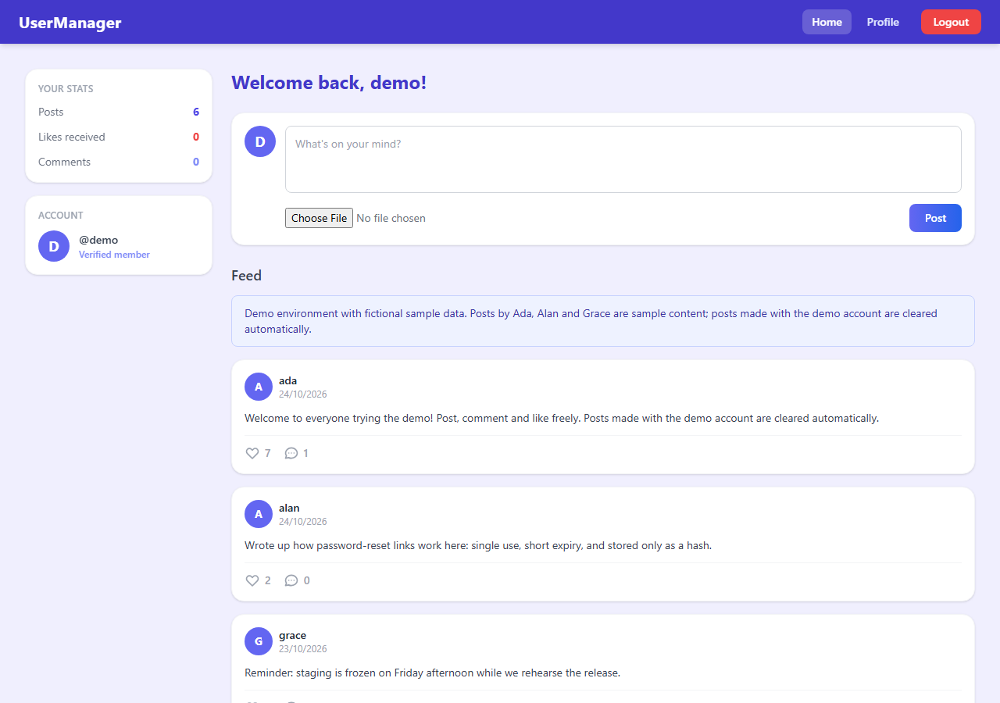

# UserManager — Frontend

React single-page application for UserManager: sign-up with email verification, login,
password recovery, profile management, a social feed of posts and comments, and an admin
panel for managing accounts.

**Live demo:** [usermanager-frontend.vercel.app](https://usermanager-frontend.vercel.app)
(use **Fill demo login** on the sign-in page) · **Backend repository:**
[tizreal/UserManager-Backend](https://github.com/tizreal/UserManager-Backend)

The demo is pre-loaded with fictional sample data: posts by the Ada, Alan and Grace accounts
are sample content, and posts made with the demo account are cleared automatically.



## Tech stack

React 19 · Vite · React Router 7 · Axios · Formik and Yup · Tailwind CSS · ESLint ·
GitHub Actions · Vercel

## Features

- **Account flows:** registration, email verification, login, forgot and reset password.
  The verification and reset pages read the token from the emailed link.
- **Profile:** edit profile details, change password or email (both require the current
  password; a new email is confirmed from its own inbox), and delete the account.
- **Feed:** create posts with an optional image, comment, like and unlike, and delete your
  own posts.
- **Admin panel:** list accounts with their status, and deactivate, reactivate or delete
  them. Shown only to administrators; every action is also authorized by the API.
- **Demo access:** a one-click demo login. The demo account's profile and credentials are
  read-only.
- **Free-tier wake-up:** the login page checks the API's health endpoint and shows a status
  while the sleeping backend starts.

## Implementation notes

- **Routing:** public routes for the account flows; `ProtectedRoute` and `AdminRoute`
  wrappers for signed-in and admin-only pages (`src/App.jsx`).
- **API client:** `src/api.js` builds every request from `VITE_API_URL`, attaches the JWT,
  stores refreshed tokens returned after a password change, and handles any `401` globally
  by clearing the session and returning to the login page.
- **Forms:** Formik with Yup schemas for validation and inline error messages.
- **Security headers:** `vercel.json` sets a Content-Security-Policy (scripts and styles from
  the app's own origin only, API calls only to the backend), plus `X-Frame-Options: DENY`,
  `X-Content-Type-Options: nosniff`, `Referrer-Policy` and `Permissions-Policy`.

## Running locally

Requirements: Node.js 22 (the version CI uses), and the [backend](https://github.com/tizreal/UserManager-Backend)
running locally or a deployed API.

```bash
npm ci
echo "VITE_API_URL=http://localhost:8080" > .env.local   # API origin, without /api
npm run dev                                             # http://localhost:5173
```

Other scripts: `npm run lint`, `npm run build`, `npm run preview`.

## CI and deployment

GitHub Actions runs `npm ci`, `npm run lint` and `npm run build` on every push and pull
request. Vercel builds and deploys `master`; `VITE_API_URL` is set in the Vercel project.

## Project structure

```
src/
├── api.js          API client, token handling, global 401 handling
├── App.jsx         routes
├── components/     account flows, navbar, post card, route guards, server status banner
├── hooks/          backend warm-up check
└── pages/          home feed, profile, edit profile, admin panel
```
